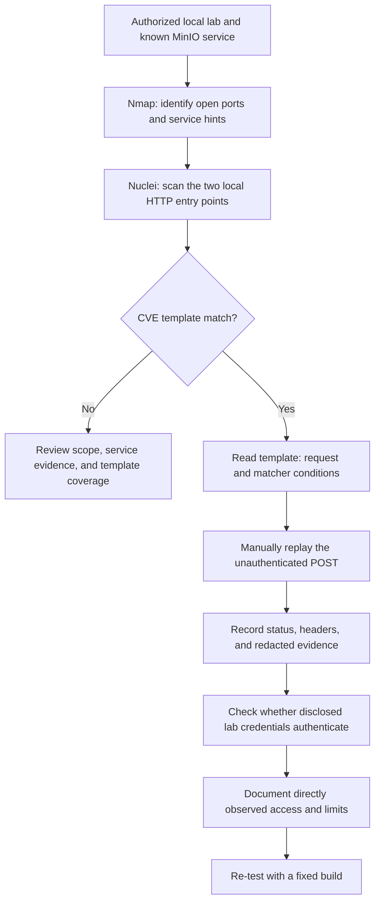

# CVE-2023-28432 MinIO Lab Report

## Scope and safety

This report documents a local, isolated, three-node MinIO exercise. The host API and Console ports are bound to loopback (`127.0.0.1`). No production tenant, service, customer data, or credentials were involved. The credential values and full sensitive response values are intentionally omitted.

The Compose file reads the root username and password from environment variables so secrets are not committed. Set unique lab-only values in the shell before starting the stack. Do not reuse real credentials.

## Objective

Understand and reproduce the unauthenticated information disclosure described by [MinIO advisory GHSA-6xvq-wj2x-3h3q](https://github.com/minio/minio/security/advisories/GHSA-6xvq-wj2x-3h3q), then verify whether disclosed lab credentials can authenticate to the local Console.

## Environment

- Product: MinIO distributed deployment, three nodes.
- Vulnerable image tag used during the exercise: `2023-02-27T18-10-45Z`.
- Local API: `http://127.0.0.1:9000`.
- Local Console: `http://127.0.0.1:9001`.
- These addresses are observations from the lab setup, not external targets.

## Investigation steps and evidence

### 1. Service discovery

Nmap was scoped to the two expected local ports:

```bash
nmap -sV -p 9000,9001 127.0.0.1
```

Both TCP ports were open. Nmap identified port 9000 as the MinIO S3-compatible HTTP service and port 9001 as the MinIO Console HTTP service. This identified the services, but did not reveal application routes.

### 2. Template-based detection

Nuclei was run against the two local HTTP entry points. Its CVE-2023-28432 template reported a match at:

```text
http://127.0.0.1:9000/minio/bootstrap/v1/verify
```

The match was a useful lead. The template sends one unauthenticated `POST` request and requires all three matcher groups to pass:

1. Status is `200`.
2. A response header contains `text/plain`.
3. The body contains at least one of `MINIO_ROOT_PASSWORD`, `MINIO_ROOT_USER`, or `MinioEnv` as a JSON key marker.

The route was learned from the known CVE template/advisory; Nmap did not discover it. The template source used for comparison is copied to `nuclei-template.yaml` in this directory.

### 3. Manual request reproduction

The Python scripts reproduce the template request against the local lab. `request_minio_verify.py` prints the status, headers, and full response body. `../reproduce_cve_2023_28432.py` also evaluates the Nuclei matcher conditions and writes the raw response body to standard output so it can be piped to `jq`.

Observed result: HTTP `200`, a `text/plain` content type, and the expected configuration markers. The response contained cluster endpoint details and MinIO environment configuration, including root credential fields. Credential values are omitted from this report.

### 4. Credential validation

The disclosed lab credentials were used to log into the Console at `http://127.0.0.1:9001`. Login succeeded, confirming that the exposed credentials were valid for this lab. The exercise did not establish a complete permission inventory; do not infer specific data access beyond what was directly observed.

## Workflow



## Conclusion

The exercise demonstrated the chain **service identification → known-template match → manual unauthenticated response validation → lab credential authentication**. It also showed that a scanner match is a lead whose request and response conditions should be understood and independently checked.

This was a guided known-CVE reproduction: the MinIO product, local target, ports, and CVE were known in advance. It did not exercise broad asset discovery or blind endpoint discovery. The internal route came from the CVE material/template, not from Nmap or general web crawling.

## Remaining closure work

- Record the actual read-only permissions observed after Console login, if continuing the lab.
- Create a separate comparison environment using the advisory's patched version `RELEASE.2023-03-20T20-16-18Z`.
- Replay the identical unauthenticated request and inspect the full response. A Nuclei non-match alone is not sufficient proof of remediation.
- Record the comparison and then stop/remove the lab when no longer needed.

## Reproduce locally

Provide unique, lab-only values through environment variables before starting the Compose stack. The Compose configuration intentionally has no committed credential defaults.

```bash
export MINIO_ROOT_USER='lab-only-user'
export MINIO_ROOT_PASSWORD='choose-a-unique-lab-only-password'
docker compose -f labs/minio/CVE-2023-28432/docker-compose.yml up -d
```

Run the local request script:

```bash
python3 labs/minio/request_minio_verify.py
```

The response may contain credentials. Keep its output local, do not commit it, and do not use these scripts against systems outside an explicitly authorized scope.
