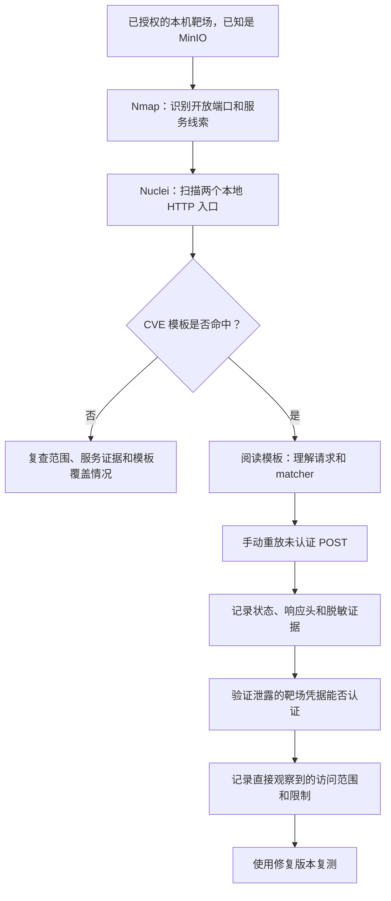

# CVE-2023-28432 MinIO 实验记录

## 范围与安全边界

本文记录一次本机隔离的 MinIO 三节点实验。宿主机 API 与 Console 端口仅绑定到回环地址（`127.0.0.1`）。实验未涉及生产租户、生产服务、客户数据或真实凭据。本文不记录凭据值，也不保留完整敏感响应。

Compose 配置从环境变量读取 Root 用户名和密码，避免将凭据提交到仓库。启动环境时应设置仅供靶场使用的唯一值，不要复用真实凭据。

## 实验目标

理解并复现 [MinIO 安全公告 GHSA-6xvq-wj2x-3h3q](https://github.com/minio/minio/security/advisories/GHSA-6xvq-wj2x-3h3q) 描述的未认证信息泄露，并验证泄露的靶场凭据能否登录本地 Console。

## 环境

- 产品：MinIO 分布式部署，共三个节点。
- 实验使用的易受影响镜像标签：`2023-02-27T18-10-45Z`。
- 本地 API：`http://127.0.0.1:9000`。
- 本地 Console：`http://127.0.0.1:9001`。
- 以上地址是靶场观测结果，不是外部目标。

## 排查过程与证据

### 1. 服务发现

Nmap 仅扫描预期的两个本机端口：

```bash
nmap -sV -p 9000,9001 127.0.0.1
```

两个 TCP 端口均开放。Nmap 将 9000 识别为 MinIO S3 兼容 HTTP 服务，将 9001 识别为 MinIO Console HTTP 服务。这一步识别了服务，但没有发现应用路由。

### 2. 基于模板的检测

使用 Nuclei 扫描两个本地 HTTP 入口。CVE-2023-28432 模板报告了以下命中地址：

```text
http://127.0.0.1:9000/minio/bootstrap/v1/verify
```

模板命中是调查线索。模板发送一次未认证 `POST` 请求，并要求以下三组 matcher 全部通过：

1. HTTP 状态码为 `200`。
2. 响应头包含 `text/plain`。
3. 响应正文至少包含 `MINIO_ROOT_PASSWORD`、`MINIO_ROOT_USER` 或 `MinioEnv` 其中一个 JSON 字段标记。

接口路径来自已知 CVE 的资料和模板；Nmap 并未发现它。本目录中的 `nuclei-template.yaml` 是用于对照的模板副本。

### 3. 手动重放请求

Python 脚本面向本机靶场重放模板请求。`request_minio_verify.py` 打印状态码、响应头和完整响应正文。`../reproduce_cve_2023_28432.py` 还会判断 Nuclei matcher 条件，并将原始响应正文输出到标准输出，因此可通过管道交给 `jq`。

观测结果：HTTP 状态码为 `200`，响应类型为 `text/plain`，正文包含预期配置字段标记。响应中包含集群端点详情和 MinIO 环境配置，包括 Root 凭据字段。本文省略凭据值。

### 4. 凭据有效性验证

使用泄露的靶场凭据登录 `http://127.0.0.1:9001` 的 Console，登录成功。这证明泄露的凭据在当前靶场有效。实验没有完成全面权限盘点；不能推断超出实际观察范围的数据访问能力。

## 排查流程图



## 结论

本次实验走通了 **服务识别 → 已知模板命中 → 手动验证未认证响应 → 靶场凭据认证** 这条链路。实验也说明，扫描器命中只是线索，需要理解其请求和响应判定条件，并独立核对实际响应。

这是一次有明确线索的已知 CVE 复现：MinIO 产品、本机目标、端口和 CVE 均已提前给出。它没有练习大范围资产发现或盲目接口发现。内部接口路径来自 CVE 资料和模板，而不是 Nmap 或通用网页爬虫。

## 尚待完成的闭环

- 如继续实验，记录 Console 登录后实际观察到的只读权限范围。
- 使用公告列出的修复版本 `RELEASE.2023-03-20T20-16-18Z` 创建独立对照环境。
- 对照环境重放相同的未认证请求并检查完整响应。仅凭 Nuclei 不再命中，不能作为修复完成的充分证据。
- 记录对照结果，结束实验后停止并按需清理靶场。

## 本机复现

启动 Compose 前，通过环境变量提供仅供实验使用的唯一凭据。配置文件没有提交凭据默认值。

```bash
cd labs/minio/CVE-2023-28432
export MINIO_ROOT_USER='lab-only-user'
export MINIO_ROOT_PASSWORD='choose-a-unique-lab-only-password'
docker compose up -d
```

发送本地请求：

```bash
python3 ../request_minio_verify.py
```

漏洞响应可能包含凭据。请将输出保留在本机，不要提交到仓库；这些脚本仅可用于明确授权的范围。
